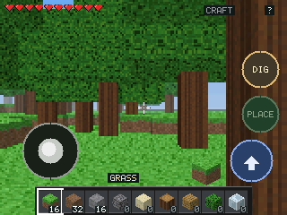

# WioCraft — Wio Tracker L2 Pro

A small voxel survival game for the **Seeed Wio Tracker L2 Pro** (ESP32-S3R8):
160x120 internal render with an integer 2x upscale to the 320x240 panel,
touch-only controls, and SD card saves.

**English** | [简体中文](README.zh-CN.md)



## Hardware

| | |
|---|---|
| MCU | ESP32-S3R8, 16 MB QIO flash + 8 MB OPI PSRAM |
| Display | 320x240 NV3031B, QSPI |
| Touch | GT911 capacitive, 5 points |
| Audio | ES8311 codec + PA |
| Storage | microSD (FAT32) |
| Expander | TCA9535 (panel reset, SD detect, PA enable, ...) |

## Install a prebuilt firmware

Grab `WioCraft-L2-v0.3-merged.bin` from the
[v0.3 release](https://github.com/zxw19/WioCraft-L2/releases) and flash it at offset 0x0:

```powershell
python -m esptool --chip esp32s3 --port COM83 -b 460800 write_flash 0x0 WioCraft-L2-v0.3-merged.bin
```

The merged image is 606,144 bytes. SHA256:

```
C8BD1A809D4A82D03583CA9E520A79286B3DA99F1327BD688499F090FF242B2E
```

## Build from source

```powershell
pio run
```

Merge bootloader, partition table and application into one image:

```powershell
python -m esptool --chip esp32s3 merge_bin -o WioCraft-merged.bin `
  --flash_mode qio --flash_freq 80m --flash_size 16MB `
  0x0 .pio\build\wio-l2\bootloader.bin `
  0x8000 .pio\build\wio-l2\partitions.bin `
  0x10000 .pio\build\wio-l2\firmware.bin
```

## Controls

- Stick, bottom left: move
- Drag anywhere else: turn / look up and down
- `DIG` (hold): mine
- `PLACE`: place a block
- `JUMP`: jump
- `CRAFT`, top right: craft (log to planks)
- `?`, top right corner: help
- Hotbar along the bottom: pick an item

## Performance (v0.3, measured on hardware)

- 21.7-22 fps in dense forest: sky 0.8 ms / world 32 ms / present 11.7 ms
- RAM 30.5%, flash 17.2%
- The frame is rendered at 160x120 and upscaled 2x; `present` is the bottleneck

## Repository layout

```
src/            engine and game (render / world / game / ui / input / save)
releases/v0.3/  source snapshot and prebuilt firmware for v0.3
logs/           device screenshots and serial logs
tests/          host-side regression tests (save, layout, render)
PROGRESS.md     per-version development notes (Chinese)
```

## Known limitations

- The SD save path (save, reboot and restore, power loss) has not been tested with a real card yet.
- Frame rate is limited by the 320x240 `present` and the 160x120 ray traversal; about 22 fps in forest.
