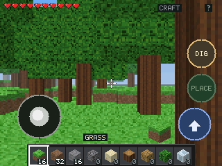

# WioCraft — Wio Tracker L2 Pro

跑在 **Seeed Wio Tracker L2 Pro**（ESP32-S3R8）上的体素生存小游戏：
160x120 内部渲染、整数 2 倍放大到 320x240、全触摸操作、SD 卡存档。

[English](README.md) | **简体中文**



## 硬件

| | |
|---|---|
| 主控 | ESP32-S3R8，16 MB QIO Flash + 8 MB OPI PSRAM |
| 屏幕 | 320x240 NV3031B，QSPI |
| 触摸 | GT911（电容，5 点） |
| 音频 | ES8311 + PA |
| 存储 | TF 卡（FAT32） |
| 扩展 | TCA9535 IO 扩展器（屏复位、SD 检测、PA 使能等） |

## 烧录预编译固件

从 [v0.3 Release](https://github.com/zxw19/WioCraft-L2/releases) 下载
`WioCraft-L2-v0.3-merged.bin`，从 0x0 写入：

```powershell
python -m esptool --chip esp32s3 --port COM83 -b 460800 write_flash 0x0 WioCraft-L2-v0.3-merged.bin
```

合并镜像 606,144 字节，SHA256：

```
C8BD1A809D4A82D03583CA9E520A79286B3DA99F1327BD688499F090FF242B2E
```

## 从源码构建

```powershell
pio run
```

合并 bootloader、分区表与应用：

```powershell
python -m esptool --chip esp32s3 merge_bin -o WioCraft-merged.bin `
  --flash_mode qio --flash_freq 80m --flash_size 16MB `
  0x0 .pio\build\wio-l2\bootloader.bin `
  0x8000 .pio\build\wio-l2\partitions.bin `
  0x10000 .pio\build\wio-l2\firmware.bin
```

## 操作

- 左下摇杆：移动
- 其余区域拖动：转向 / 抬头低头
- `DIG` 按住：挖
- `PLACE`：放置
- `JUMP`：跳
- 右上 `CRAFT`：合成（原木 → 木板）
- 右上 `?`：帮助
- 底部快捷栏：选择物品

## 性能（v0.3，实机）

- 密林场景 21.7–22 fps：sky 0.8 ms / world 32 ms / present 11.7 ms
- RAM 30.5%，Flash 17.2%
- 画面 160x120 渲染后 2 倍放大；`present` 是当前的瓶颈

## 目录

```
src/            引擎与游戏（render / world / game / ui / input / save）
releases/v0.3/  v0.3 的源码快照与预编译固件
logs/           实机截图与串口日志
tests/          主机侧回归（存档、布局、渲染）
PROGRESS.md     逐版本开发记录与踩坑
```

## 已知限制

- 真实 SD 卡持久化流程（保存 / 重启恢复 / 掉电）还没有插卡验证。
- 帧率受 320x240 的 `present` 与 160x120 的射线遍历限制，密林约 22 fps。
